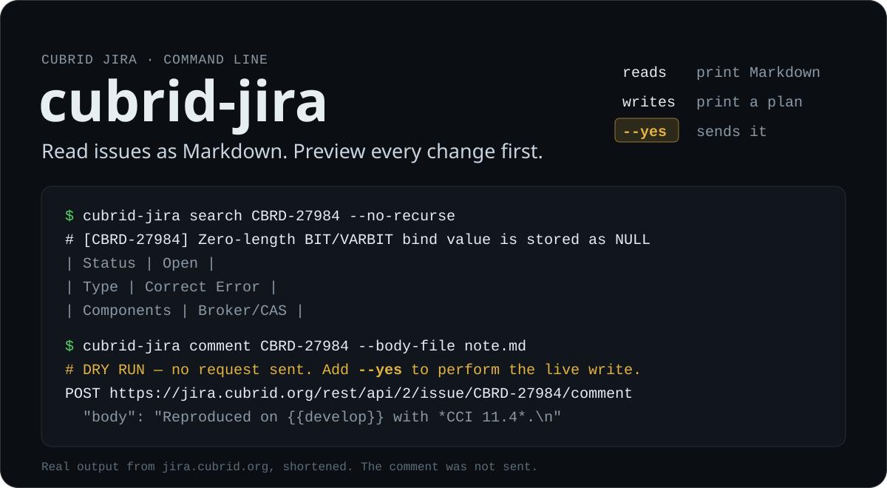

<p align="center">
  
</p>

<p align="center">
  <a href="#install">Install</a> ·
  <a href="#quick-start">Quick start</a> ·
  <a href="docs/commands.md">Commands</a> ·
  <a href="docs/agent-guide.md">Agent guide</a> ·
  <a href="#documentation">Docs</a>
</p>

`cubrid-jira` is a command-line client for CUBRID's JIRA Server at
`jira.cubrid.org`, and for `jira.cubrid.com` when you ask for it. It prints
issues as Markdown that you, a script, or an AI agent can read. Every write
prints the exact requests it would send and sends nothing until you add
`--yes`.

## What it does

| You want to | Run |
|---|---|
| Read an issue as Markdown | `cubrid-jira search CBRD-27984` |
| List issues that match a JQL query | `cubrid-jira jql "project = CBRD AND status = Open"` |
| Download attachments, skipping huge files | `cubrid-jira attachment CBRD-27984 --list` |
| See your open tickets by status | `cubrid-jira-kanban` |
| Create, comment, link, assign, update, or transition | `cubrid-jira create`, `comment`, `link`, `assign`, `update`, `transition` |
| Move a sub-task to another parent | `cubrid-jira reparent CBRD-XXXXX --to CBRD-YYYYY` |

Each command and flag is described in the [command reference](docs/commands.md).

## Install

You need Python 3.14 or later and [pandoc](https://pandoc.org/) with the `jira`
format. Use pandoc 2.19 or later.

```sh
uv tool install git+https://github.com/vimkim/cubrid-jira.git
```

`pipx install` works too. [Set up cubrid-jira](docs/setup.md) covers pandoc
versions, credentials, the second server, and where files go.

## Quick start

**1. Read an issue.** Reads need no account for public projects.

```console
$ cubrid-jira search CBRD-27984 --no-recurse
# [CBRD-27984] Zero-length BIT/VARBIT bind value is stored as NULL

<https://jira.cubrid.org/browse/CBRD-27984>

## Metadata

| Field | Value |
|---|---|
| Status | Open |
| Type | Correct Error |
| Components | Broker/CAS |
...
```

The Markdown goes to stdout and progress goes to stderr, so you can pipe the
result or save it.

**2. Query issues as JSON.**

```console
$ cubrid-jira jql 'project = CBRD AND component = "Broker/CAS" ORDER BY created DESC' \
    --max 3 --output json | jq -r '.issues[] | .key + "  " + .fields.summary'
CBRD-27984  Zero-length BIT/VARBIT bind value is stored as NULL
CBRD-27863  CAS login fetches the INFORMATION_SCHEMA user from the server every time
CBRD-27786  prepare 의미 오류의 실행 시점 지연(unprepared fallback)을 바인딩 값이 있어야 컴파일되는 문장으로 한정
```

**3. Preview a change.** Writes need credentials, even for a preview.

```sh
export CUBRID_JIRA_USER=your-jira-username
export CUBRID_JIRA_PASSWORD=your-jira-password
echo 'Reproduced on `develop` with **CCI 11.4**.' > note.md
```

```console
$ cubrid-jira comment CBRD-27984 --body-file note.md
# DRY RUN — no request sent. Add --yes to perform the live write.
POST https://jira.cubrid.org/rest/api/2/issue/CBRD-27984/comment
  Authorization: Basic <base64(your-jira-username:***)>
  Content-Type: application/json
  Accept: application/json
Body:
{
  "body": "Reproduced on {{develop}} with *CCI 11.4*.\n"
}
```

The CLI converted the Markdown to Jira wiki markup and stopped there.

**4. Send it.** Run the same command with `--yes`, against an issue you mean
to change:

```sh
cubrid-jira comment CBRD-XXXXX --body-file note.md --yes
```

## Why it is safe to hand to an agent

- **Writes are dry runs by default.** Without `--yes`, every write prints its
  method, URL, masked headers, and body. `--output json` turns that plan into
  one JSON object that a script can check.
- **A failed login stops the command.** JIRA Server locks an account behind a
  CAPTCHA after a few failed logins. `cubrid-jira` exits with code 2 on the
  first HTTP 401 and never retries.
- **Results and noise stay apart.** stdout carries only the result. Progress
  and errors go to stderr. Exit codes 2, 3, 4, and 5 stand for HTTP 401, 403,
  404, and 400.
- **Partial failures say how to finish.** If `create` makes the issue but a
  link request fails, stderr prints the new key and the exact `link` command
  that completes the job.
- **It works where the REST API fails silently.** On `jira.cubrid.org`, setting
  a sub-task's parent through REST returns success and changes nothing.
  `reparent` drives the web UI's Convert wizard instead.
- **Markdown survives the trip.** pandoc converts each body to Jira wiki
  markup. The CLI also fixes spacing where Korean text touches inline markup,
  keeps code that contains `{code}` intact, and rejects Markdown tables whose
  columns could shift.

Exit codes and JSON shapes are listed in
[Output and exit codes](docs/output-and-exit-codes.md).

## Use it from an AI agent

Install the [`cubrid-jira` agent skill](https://github.com/vimkim/my-cubrid-skills/tree/main/cubrid-jira)
from [my-cubrid-skills](https://github.com/vimkim/my-cubrid-skills). It teaches
an agent to read an issue by key and to publish a reviewed Markdown file as an
issue description, with a dry run first.

```sh
npx skills add vimkim/my-cubrid-skills --skill cubrid-jira
```

To drive the CLI from your own agent instructions, point the agent at the
[agent guide](docs/agent-guide.md). It holds the contract: the `--yes` gate,
the 401 rule, the output streams, and what to do for each exit code.

## Two JIRA servers

`jira.cubrid.org` is the default and hosts `CBRD`. `RND` issues live on
`jira.cubrid.com`, which you select per command:

```sh
cubrid-jira search RND-2851 --server http://jira.cubrid.com
```

`RND` issues are not visible without an account, so this server needs its own
credentials. It also serves only plain HTTP, so those credentials travel
unencrypted. See [Pick the server](docs/setup.md#pick-the-server).

## Documentation

| Page | Read it to |
|---|---|
| [Set up cubrid-jira](docs/setup.md) | Install pandoc, add credentials, pick a server, find cached files, and fix setup errors. |
| [Command reference](docs/commands.md) | Look up every subcommand, flag, and cache effect. |
| [Output and exit codes](docs/output-and-exit-codes.md) | Parse JSON output and handle exit codes in scripts. |
| [Recipes](docs/recipes.md) | Create a bug, edit a comment, resolve an issue, move a sub-task, and more, step by step. |
| [Agent guide](docs/agent-guide.md) | Run `cubrid-jira` from an AI agent safely. |
| [Development](docs/development.md) | Run the tests, use the `just` recipes, and find the background notes. |

## Development

```sh
git clone https://github.com/vimkim/cubrid-jira.git
cd cubrid-jira
uv sync --dev
uv run pytest
```

[`CLAUDE.md`](CLAUDE.md) holds the module layout and the rules for changing the
code. [Development](docs/development.md) lists the `just` recipes and the
design notes. File bugs and feature requests in
[GitHub Issues](https://github.com/vimkim/cubrid-jira/issues).
